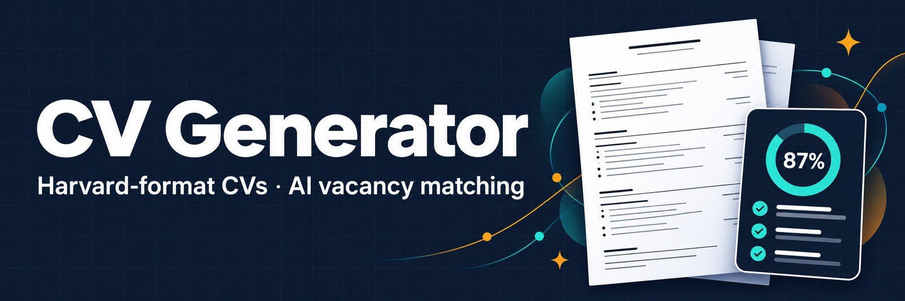
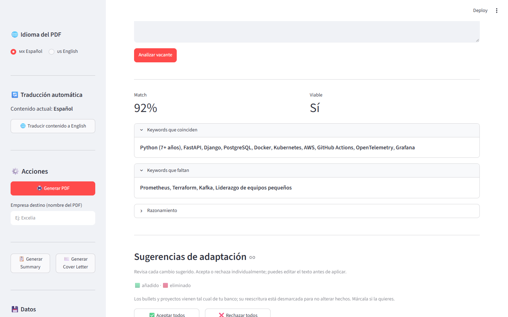
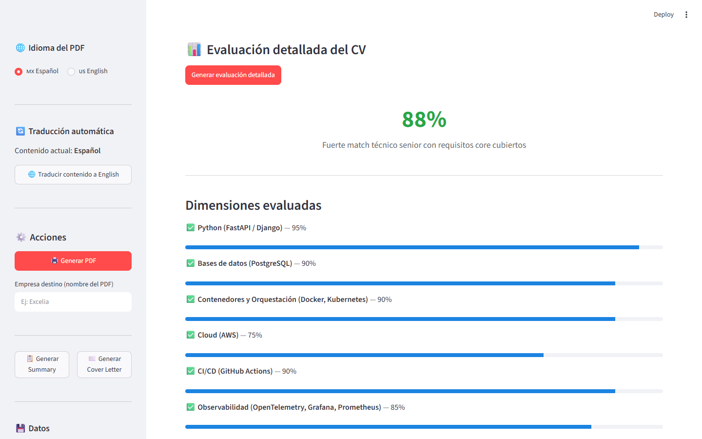
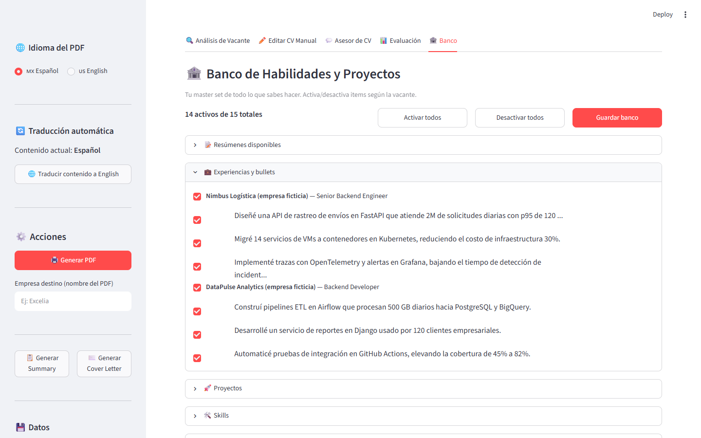
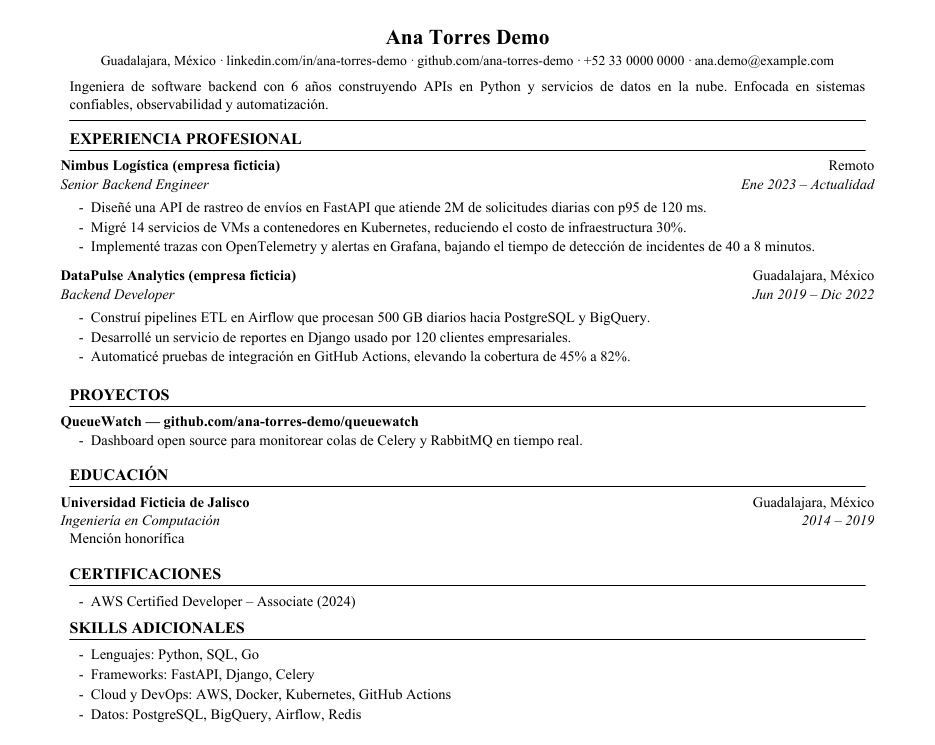

<div align="center">

# 📄 CV Generator — Formato Harvard

<p align="center">
  
</p>

<p align="center">
  
  
  
  
  
</p>

</div>

---

Generador de CV en formato Harvard, optimizado para ATS, que adapta tu CV a cada vacante con IA. Pegas la vacante (o una captura) y obtienes un match score, las keywords que coinciden y las que faltan, y sugerencias de adaptación que puedes aceptar una por una. Todo sale de un **banco personal** con tu experiencia real, y hay guards que impiden que la IA invente métricas o infle tu nivel en las skills.

> [!TIP]
> Activa o desactiva experiencias, bullets y skills en el tab **🏦 Banco** para armar una versión del CV por vacante sin perder nada del master set.

> [!IMPORTANT]
> Tus datos personales (banco, config y API keys) se guardan solo en la carpeta local `data/`, que está excluida de git.

## ✨ Características

| 📝 Edición y formato | 🤖 Análisis con IA |
|---|---|
| PDF estilo Harvard, limpio y legible por ATS | 5 proveedores: **Groq** (default), Ollama Cloud, OpenAI, Anthropic y Gemini |
| Secciones de experiencia, proyectos, educación, **certificaciones** y skills | Match score, keywords que coinciden/faltan y razonamiento |
| Edición manual en tiempo real e importación desde JSON | **OCR de vacante** con Gemini Vision: sube una captura en lugar de pegar texto |
| Traducción automática del contenido ES ↔ EN | Sugerencias de adaptación editables, con diff añadido/eliminado |
| Interfaz bilingüe (Español / English) | Evaluación detallada por dimensión y por requisito, con veredictos |

| 🛡️ Anti-fabricación | ✍️ Contenido extra |
|---|---|
| Bloquea métricas que no existen en tu banco | **Summary** de ~60 palabras adaptado a la vacante |
| No eleva skills a un tier mayor del que respalda la evidencia | **Cover letter** con CV, vacante y empresa como contexto |
| Detección de overfitting y keyword stuffing | **Asesor de CV**: chat para redactar bullets y recibir feedback |
| Limpieza de errores típicos de la IA (palabras pegadas, idiomas mezclados) | Chat de refinamiento: cuéntale experiencia que no está en el CV y re-analiza |

## 📸 Capturas

> Capturas tomadas con datos ficticios.

<table>
  <tr>
    <td width="50%"><b>Análisis de vacante</b><br></td>
    <td width="50%"><b>Evaluación detallada</b><br></td>
  </tr>
  <tr>
    <td width="50%"><b>Banco de habilidades</b><br></td>
    <td width="50%"><b>PDF generado</b><br></td>
  </tr>
</table>

## 🛠️ Stack

| Categoría | Tecnología |
|-----------|-----------|
| UI | Streamlit |
| PDF | ReportLab (generación), pypdf |
| LLM | httpx contra las APIs de cada proveedor, tenacity para reintentos |
| Validación | Pydantic v2 |
| Traducción | deep-translator (Google Translate) |
| Tests | pytest |

## 🚀 Instalación

### Requisitos

- Python 3.10 o superior (probado en 3.12)
- Una API key de al menos un proveedor LLM (para las funciones de IA)

### Pasos

```bash
git clone https://github.com/AlexVitesse/CV_generator.git
cd CV_generator
python -m venv venv
source venv/bin/activate        # Windows: venv\Scripts\activate
pip install -r requirements.txt
streamlit run app.py
```

La app abre en `http://localhost:8501`.

### Configuración de IA

Elige el proveedor en la barra lateral e ingresa su API key. Cada proveedor guarda su propia key y modelo, así que puedes alternar sin perderlos. El modelo se elige de una lista sugerida (`MODEL_OPTIONS` en `cvgen/llm_client.py`) o puedes escribir cualquier otro id.

| Proveedor | Modelo default (editable) | Dónde obtener la key |
|-----------|---------------------------|----------------------|
| **Groq (default)** | `openai/gpt-oss-120b` | [console.groq.com](https://console.groq.com) |
| Ollama Cloud | `gpt-oss:120b-cloud` | [ollama.com](https://ollama.com) |
| OpenAI | `gpt-6.1-sol` | [platform.openai.com](https://platform.openai.com) |
| Anthropic (Claude) | `claude-opus-5-5` | [console.anthropic.com](https://console.anthropic.com) |
| Google Gemini | `gemini-3.8-flash` | [aistudio.google.com](https://aistudio.google.com) |

El **OCR de vacante** usa Gemini Vision. Necesitas una key de Gemini guardada, aunque tu proveedor activo sea otro.

### Variables de entorno

| Variable | Descripción | Requerida |
|----------|-------------|-----------|
| `OLLAMA_API_KEY` | Key de Ollama Cloud; tiene prioridad sobre la guardada en la app | No |
| `CV_DEBUG` | Si está activa, guarda dumps JSON de cada llamada a la IA en `logs/` | No |

### Tus datos

| Archivo | Contenido |
|---------|-----------|
| `data/banco_personal.json` | Banco con todas tus experiencias, bullets, proyectos y skills. Al guardar se crea un respaldo `.bak` |
| `data/config_personal.json` | CV base. Si no hay banco, la app lo crea a partir de este archivo la primera vez |
| `data/.ai_config.json` | Proveedor activo, API keys y modelos |

Para empezar, copia `config_plantilla.json` a `data/config_personal.json` y llénalo con tu información. También puedes partir de cero desde el tab **✏️ Editar CV Manual**.

## 🎮 Uso

1. Carga tu CV desde el banco, importando un JSON o en **✏️ Editar CV Manual**.
2. En **🔍 Análisis de Vacante**, pega la vacante o sube una captura (OCR) y pulsa **Analizar vacante**. El score aparece arriba.
3. Revisa las sugerencias, edítalas y aplica las que quieras. Si la vacante está en otro idioma, el CV se traduce antes de re-evaluar.
4. Si tienes experiencia que no está en el CV, abre el chat de refinamiento, cuéntasela a la IA y vuelve a analizar.
5. En **📊 Evaluación**, genera el desglose por dimensiones y requisitos.
6. En **💬 Asesor de CV**, pide ayuda para redactar bullets o feedback general.
7. En **🏦 Banco**, activa o desactiva items para esta vacante y guarda.
8. Desde la barra lateral, genera el **Summary** o la **Cover Letter**, escribe el nombre de la empresa y descarga el PDF.

## 📂 Estructura

```
app.py                 entrada de Streamlit
config_plantilla.json  plantilla de CV
cvgen/
  ai_analyzer.py       análisis, evaluación, selección del banco y guards
  llm_client.py        cliente multi-proveedor, reintentos y logging
  banco.py             banco personal: carga, guardado y migración
  pdf.py               generación del PDF Harvard
  metrics_guard.py     detección de métricas fabricadas
  validation.py        esquemas Pydantic de las respuestas de la IA
  translate.py  i18n.py  helpers.py  session_keys.py
  prompts/             prompts en Markdown
  ui/                  tabs, sidebar, navbar y visor de diffs
data/                  tus datos personales (ignorado por git)
docs/                  notas de diseño, fixes y planes
tests/                 suite de pytest
```

## 🧪 Tests

```bash
pytest
```

`tests/e2e_filter_test.py` es una prueba manual end-to-end que llama a un LLM real y necesita una API key. No forma parte de la suite de `pytest`.

<details>
<summary>🧩 <b>Problemas comunes</b></summary>

- **El banco aparece vacío** — La app busca `data/banco_personal.json`. Si actualizaste desde una versión que guardaba los datos en la raíz, mueve `banco_personal.json`, `config_personal.json` y `.ai_config.json` a `data/`.
- **El botón de OCR está deshabilitado** — Falta guardar una API key de Gemini en la barra lateral.
- **"Pega el texto de una vacante primero"** — Streamlit toma el texto al salir del campo. Haz clic fuera del área de texto o pulsa `Ctrl+Enter` antes de analizar.

</details>

## 📝 Notas

### Limitaciones conocidas

- El score lo calcula un LLM, así que puede variar un poco entre ejecuciones y entre proveedores.
- La traducción usa Google Translate vía deep-translator y requiere conexión a internet.
- Todo es local y de un solo usuario: no hay cuentas ni base de datos.

### Decisiones de diseño

- **Banco con bullets textuales** en vez de dejar que la IA reescriba libremente, para que el CV no diga nada que no hayas escrito tú.
- **JSON local** en vez de una base de datos, porque es una herramienta personal y así los datos son fáciles de respaldar y editar.

## 📄 Licencia

MIT — ver [LICENSE](LICENSE).

---

<div align="center">

**Hecho por [AlexVitesse](https://github.com/AlexVitesse)**

</div>
